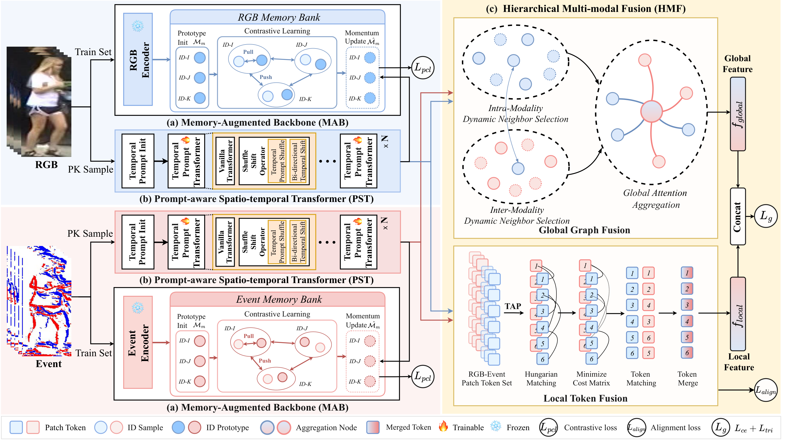

# Paths: Prompt-aware Spatio-temporal Transformer with Hierarchical Multi-modal Fusion for RGB-Event Video Person Re-Identification

<p align="center">
  <a href="https://doi.org/10.1145/3767308.3835505"></a>
  <a href="https://github.com/Reflection0427/Paths"></a>
  <a href="https://huggingface.co/Reflection0427/Paths"></a>
</p>

<p align="center">
  <a href="https://github.com/Reflection0427">Yakun Huo</a>,
  <a href="https://github.com/AWangYQ">Yingquan Wang</a>,
  <a href="https://github.com/010129">Yangyang Liu</a>,
  <a href="https://github.com/Drchip61">Tianyu Yan</a>,
  <a href="https://scholar.google.com/citations?user=-37EfvgAAAAJ">Yunzhi Zhuge</a>,
  <a href="https://scholar.google.com/citations?user=MfbIbuEAAAAJ">Pingping Zhang</a>,
  <a href="https://faculty.dlut.edu.cn/huchuan_Lu/en/index.htm">Huchuan Lu</a>
</p>

Official PyTorch implementation of **Paths** (ACM MM 2026), a framework for RGB-Event Video Person Re-Identification (RE-VReID). It models space and time jointly and fuses the RGB and event streams at two levels:

- **Memory-Augmented Backbone (MAB)** keeps a separate set of identity prototypes for each modality across mini-batches. These make intra-modal representation learning more stable.
- **Prompt-aware Spatio-temporal Transformer (PST)** models spatial and temporal cues inside one Transformer using temporal prompts, Temporal Prompt Shuffle (TPS) and Bidirectional Temporal Shift (BTS).
- **Hierarchical Multi-modal Fusion (HMF)** fuses RGB and event features at two levels: globally with Global Graph Fusion (GGF), and locally with Local Token Fusion (LTF), which matches tokens by Hungarian matching and adds a cross-modal alignment loss.

## Framework

<p align="center">
  
</p>

## Main Results

Paths\* uses a CLIP-B/16 backbone and Paths† uses DINOv3 ViT-B/16.

**EvReID** (Table 1)

| Method | Backbone | mAP | R-1 | R-5 | R-10 | Config |
|---|---|---|---|---|---|---|
| Paths\* | CLIP-B/16 | 71.1 | 89.3 | 94.6 | 96.5 | [`configs/EvReID/paths_clip.yml`](configs/EvReID/paths_clip.yml) |
| Paths† | DINOv3 | 73.6 | 90.8 | 96.2 | 97.8 | [`configs/EvReID/paths_dinov3.yml`](configs/EvReID/paths_dinov3.yml) |

**MARS** (Table 2)

| Method | Backbone | mAP | R-1 | Config |
|---|---|---|---|---|
| Paths\* | CLIP-B/16 | 88.1 | 91.3 | [`configs/MARS/paths_clip.yml`](configs/MARS/paths_clip.yml) |
| Paths† | DINOv3 | 89.4 | 92.5 | [`configs/MARS/paths_dinov3.yml`](configs/MARS/paths_dinov3.yml) |

**iLIDS-VID** (Table 3)

| Method | Backbone | Blur mAP | Blur R-1 | Occ. mAP | Occ. R-1 | Configs |
|---|---|---|---|---|---|---|
| Paths\* | CLIP-B/16 | 74.0 | 63.1 | 86.0 | 75.1 | `configs/iLIDSVID/paths_clip_{blur,occlusion}.yml` |
| Paths† | DINOv3 | 74.9 | 65.2 | 88.3 | 76.4 | `configs/iLIDSVID/paths_dinov3_{blur,occlusion}.yml` |

**Component ablation on EvReID** (Table 4, DINOv3)

| MAB | PST | HMF | mAP | R-1 | Config |
|---|---|---|---|---|---|
|   |   |   | 61.0 | 80.5 | `ablation/t4_row1_baseline.yml` |
| ✓ |   |   | 63.4 | 82.3 | `ablation/t4_row2_mab.yml` |
| ✓ | ✓ |   | 68.8 | 86.5 | `ablation/t4_row3_mab_pst.yml` |
| ✓ |   | ✓ | 69.2 | 87.8 | `ablation/t4_row4_mab_hmf.yml` |
| ✓ | ✓ | ✓ | 73.6 | 90.8 | `paths_dinov3.yml` |

All ablation configs are in `configs/EvReID/ablation/`. Table 6 row 4 (HMF without the alignment loss) is `ablation/t6_row4_no_align.yml`.

## Repository Structure

```text
Paths/
├── configs/                 # one YAML per experiment in the paper
│   ├── EvReID/              # Table 1, plus ablation/ for Tables 4 and 6
│   ├── MARS/                # Table 2
│   └── iLIDSVID/            # Table 3 (blur / occlusion)
├── config/defaults.py       # all options with their defaults
├── data/                    # dataset parsers, video loader, identity sampler
├── engine/processor.py      # training and evaluation loops
├── layers/                  # ID and triplet losses
├── modeling/
│   ├── paths_model.py       # top-level Paths model
│   ├── backbone_router.py   # CLIP / DINOv3 backbones + PST integration
│   ├── modules/mab/         # Memory-Augmented Backbone (Sec. 3.1)
│   ├── modules/pst/         # Prompt-aware Spatio-temporal Transformer (Sec. 3.2)
│   ├── modules/hmf/         # Hierarchical Multi-modal Fusion: GGF + LTF (Sec. 3.3)
│   ├── clip/                # CLIP visual encoder (MIT License)
│   └── dinov3/              # DINOv3 backbone (DINOv3 License)
├── solver/                  # Adam optimizer, warm-up + cosine schedule
├── utils/                   # metrics, logging, sequence transforms
├── visualize/               # optional test-time visualizations
├── scripts/                 # one script per paper table
├── train.py
├── test.py
└── profile_model.py         # parameters / FLOPs / latency
```

## Installation

```bash
git clone https://github.com/Reflection0427/Paths.git
cd Paths
conda create -n paths python=3.10 -y
conda activate paths
pip install torch==2.1.1 torchvision==0.16.1 --index-url https://download.pytorch.org/whl/cu118
pip install -r requirements.txt
```

> Do not install `transformers` in this environment. Recent versions of it break `import torchvision` with torch 2.1 (`AttributeError: module 'torch.utils._pytree' has no attribute 'register_pytree_node'`).

## Pretrained Weights

Put the backbone weights in `pretrained/`, or point the config at them with `MODEL.CLIP_PATH` / `MODEL.PRETRAIN_PATH_T`:

```text
pretrained/
├── ViT-B-16.pt     # OpenAI CLIP ViT-B/16 (https://github.com/openai/CLIP)
└── Dinov3.pth      # DINOv3 ViT-B/16 (https://github.com/facebookresearch/dinov3)
```

Training stops with an error if the DINOv3 checkpoint is missing, so it never silently falls back to random weights.

## Dataset Preparation

Put the datasets in `datasets/`, or override the paths with `DATASETS.ROOT_DIR` / `DATASETS.EVENT_ROOT`. The `datasets/` folder is separate from the `data/` folder, which holds the loader code.

```text
datasets/
├── EvReID/
│   ├── rgb_degrade/{train,test}/<pid>/*.bmp
│   ├── event/{train,test}/<pid>/*.bmp
│   └── info/{train_name.txt, test_name.txt, tracks_train_info.mat, tracks_test_info.mat, query_IDX.mat}
├── MARS/
│   ├── rgb/{bbox_train,bbox_test}/<pid>/*.jpg
│   ├── event/{bbox_train,bbox_test}/<pid>/*.jpg
│   └── info/   (same files as EvReID)
└── i-LIDS-VID/
    ├── i-LIDS-VID_blur/sequences/{cam1,cam2}/<person>/*.png    # RGB, blur setting
    ├── i-LIDS-VID_block/sequences/{cam1,cam2}/<person>/*.png   # RGB, occlusion setting
    ├── i-LIDS-VID_mat_divide_jpg/sequences/{cam1,cam2}/...     # event frames
    └── train-test people splits/train_test_splits_ilidsvid.mat
```

For iLIDS-VID, `DATASETS.DEGRADE` (`blur` or `block`) selects the RGB folder. The loaders save the parsed splits as JSON caches next to the data. If you move the dataset, delete these caches, because they store full image paths.

## Training

Every experiment in the paper has its own config. For example:

```bash
python train.py --config_file configs/EvReID/paths_dinov3.yml
```

Options can be overridden on the command line:

```bash
python train.py --config_file configs/MARS/paths_clip.yml \
    DATASETS.ROOT_DIR /path/to/MARS MODEL.DEVICE_ID 0 OUTPUT_DIR logs/MARS_CLIP
```

One script runs all experiments for each table: `scripts/train_evreid.sh`, `scripts/train_mars.sh`, `scripts/train_ilidsvid.sh` and `scripts/ablation_evreid.sh`. Training evaluates every epoch and writes `<OUTPUT_DIR>/train_log_*.txt` and `<OUTPUT_DIR>/Paths_best.pth`.

All experiments ran on a single 80 GB A100/A800 GPU.

## Trained Models

Trained checkpoints are on [Hugging Face](https://huggingface.co/Reflection0427/Paths). The numbers below were measured with `test.py` on these exact files.

| Checkpoint | Dataset | Backbone | mAP | R-1 | R-5 | R-10 |
|---|---|---|---|---|---|---|
| [`paths_evreid_clip.pth`](https://huggingface.co/Reflection0427/Paths/resolve/main/paths_evreid_clip.pth) | EvReID | CLIP-B/16 | 71.2 | 88.9 | 94.9 | 96.8 |
| [`paths_evreid_dinov3.pth`](https://huggingface.co/Reflection0427/Paths/resolve/main/paths_evreid_dinov3.pth) | EvReID | DINOv3 | 73.9 | 89.6 | 96.2 | 97.2 |
| [`paths_mars_dinov3.pth`](https://huggingface.co/Reflection0427/Paths/resolve/main/paths_mars_dinov3.pth) | MARS | DINOv3 | 88.8 | 91.0 | 97.6 | 98.4 |

```bash
hf download Reflection0427/Paths paths_evreid_dinov3.pth --local-dir weights
python test.py --config_file configs/EvReID/paths_dinov3.yml TEST.WEIGHT weights/paths_evreid_dinov3.pth
```

## Evaluation

To evaluate a model you trained yourself:

```bash
python test.py --config_file configs/EvReID/paths_dinov3.yml TEST.WEIGHT logs/EvReID_DINOv3/Paths_best.pth
```

To also write rank lists, t-SNE and similarity plots, add `--vis-enable --vis-rank-list --vis-tsne --vis-similarity`.

## Paper ↔ Code

| Paper | Code / config |
|---|---|
| Sampled frames T = 8, input 256×128 | `INPUT.SEQ_LEN`, `MODEL.PST_SEQ_LEN`, `INPUT.SIZE_TRAIN` |
| Batch: 16 identities × 4 tracklets | `SOLVER.IMS_PER_BATCH: 64`, `DATALOADER.NUM_INSTANCE: 4` |
| Adam, 10-epoch linear warm-up, cosine decay, 80 epochs (120 on MARS) | `SOLVER.*`, `solver/scheduler_factory.py` |
| MAB prototypes and momentum μ | `modeling/modules/mab/memory_bank.py`, `engine/processor.py` |
| PST: G = 8 prompt tokens, g = 2 groups; TPS / BTS | `MODEL.PST_PROMPT_LEN`, `MODEL.PST_PROMPT_GROUPS`, `modeling/modules/pst/core.py` |
| GGF with K_intra = K_inter = 3 | `modeling/modules/hmf/global_graph.py` |
| LTF with Hungarian matching | `modeling/modules/hmf/local_token_fusion.py` |
| λ1 = 0.3 (L_pcl), λ2 = 0.1 (L_align) | `MODEL.MAB_LOSS_WEIGHT`, `MODEL.HMF_ALIGN_LOSS_WEIGHT` |

### Implementation notes

The released configs are the settings that produced the paper's results. They differ from the text of the paper in a few places:

- **Learning rate.** The results use `SOLVER.BASE_LR: 0.0005` (5e-4), except MARS with CLIP, which uses 0.00035. The value 5e-6 given in the paper is a typo.
- **Additional loss terms.** Besides L_ce, L_tri, L_pcl and L_align, training also uses a frame-level ID loss (`MODEL.FRAME_LOSS_WEIGHT`) and a cross-modal supervised contrastive loss (`MODEL.CM_SUPCON_LOSS_WEIGHT`), and the ID loss is scaled by `MODEL.ID_LOSS_WEIGHT`.
- **MAB momentum.** The prototype momentum is `MODEL.MAB_MOMENTUM: 0.1` (the paper says μ = 0.2).
- **Schedule.** The cosine schedule runs for `SOLVER.MAX_EPOCHS`: 80 epochs on EvReID and iLIDS-VID, 120 on MARS. The best epoch by mAP is reported.
- **iLIDS-VID.** These configs turn MAB off (`MODEL.USE_MAB: False`) and use a batch of 32 tracklets (8 identities × 4).

Loss weights and learning rate for each config:

| Config | LR | ID | Frame | L_pcl (λ1) | L_align (λ2) | CM-SupCon | Tracklets per ID |
|---|---|---|---|---|---|---|---|
| EvReID (CLIP, DINOv3), MARS DINOv3, iLIDS-VID | 5e-4 | 0.25 | 0.2 | 0.3 | 0.1 | 0.2 | 4 |
| MARS CLIP | 3.5e-4 | 0.5 | 0.1 | 0.2 | 0.05 | 0.1 | 8 |

On iLIDS-VID, L_pcl has no effect because MAB is off.

## Acknowledgements

This code builds on [TransReID](https://github.com/damo-cv/TransReID), [CLIP-ReID](https://github.com/Syliz517/CLIP-ReID), [CLIP](https://github.com/openai/CLIP), [DINOv3](https://github.com/facebookresearch/dinov3) and [timm](https://github.com/huggingface/pytorch-image-models). The bundled CLIP and DINOv3 code keep their original licenses: [`modeling/clip/LICENSE`](modeling/clip/LICENSE) and [`modeling/dinov3/LICENSE.md`](modeling/dinov3/LICENSE.md).

## Citation

```bibtex
@inproceedings{huo2026paths,
  title     = {Paths: Prompt-aware Spatio-temporal Transformer with Hierarchical Multi-modal Fusion for RGB-Event Video Person Re-Identification},
  author    = {Huo, Yakun and Wang, Yingquan and Liu, Yangyang and Yan, Tianyu and Zhuge, Yunzhi and Zhang, Pingping and Lu, Huchuan},
  booktitle = {Proceedings of the 34th ACM International Conference on Multimedia},
  year      = {2026},
  doi       = {10.1145/3767308.3835505}
}
```
